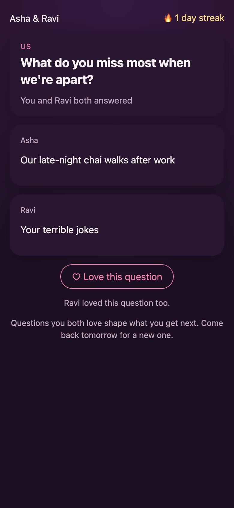

# Daily Duo

[](https://github.com/chinthanshetty07/daily-duo/actions/workflows/ci.yml)

A small real-time game for couples who are apart: one question a day, you both answer privately,
and the answers are revealed to both of you at the same moment.

> **Independent concept.** I built this after reading Kulfi's Software Engineer I posting, using only
> public information about the product. It is not affiliated with Kulfi, uses none of their code or
> content, and every question is written for this demo.
>
> **How it was built:** with Claude Code as a pair programmer. I'm stating that up front because the
> posting asks candidates to disclose AI use and to be able to explain and defend the code.



## Why this shape

Kulfi's posting says most play happens between 9 pm and midnight and that the next step is a
personalisation engine that gives every couple a new game each day. So this prototype focuses on:

- **Feeling together, live:** the partner's presence ("Ravi is here", "Ravi is typing…") updates
  over WebSockets without refreshing.
- **The reveal is the reward:** answers stay hidden until both are in. That rule is enforced on the
  server, not just hidden in the UI, and tested at both levels.
- **A daily habit:** streaks count consecutive days you both answered, and the day rolls over at
  midnight **India time**, not UTC, which matters when people play at 11:59 pm.
- **A first step toward personalisation:** hearting a question makes its category more likely on
  later days. It's a simple weighted pick, not ML, but it's deterministic, so both partners always
  get the same question, and a restart can't change today's.

## What it handles

| Situation | Behaviour |
|---|---|
| Partner hasn't joined | Shows the invite code to share (no 0/O or 1/I, since codes get read out on calls) |
| Partner typing | Live indicator, throttled on the client, and it expires on the server if the "stopped typing" message never arrives |
| You answered first | "Locked in. Waiting for Ravi"; you can edit until they answer, then it locks |
| Partner answered first | "Ravi has answered. Your turn" |
| Connection drops | Banner, exponential backoff with jitter, re-sends the session on reconnect; an answer typed meanwhile is held and sent when the socket is back |
| Phone locked / network gone | Server ping/pong drops dead sockets so "online" stays honest |
| Server restarted (demo keeps data in memory) | The client detects the unknown session and returns to onboarding with an explanation |
| Bad input | Empty or >280-character answers, bad invite codes and a full duo all get specific messages |
| Accessibility | Labelled inputs, `aria-live` status lines, visible focus, reduced-motion support |

## Run it

```bash
npm install
npm test                 # 28 tests: game rules, server over real WebSockets, UI
npm run build && npm start   # http://localhost:8787
```

To play both sides on one machine, open `http://localhost:8787` and `http://127.0.0.1:8787` (two
origins, so each keeps its own session), start a duo in one and join with the code in the other.
For development: `npm run dev:server` and `npm run dev:client` (Vite proxies `/api` and `/ws`).

## How it's built

```
React (Vite)  ──HTTP──>  Express   POST /api/duos, POST /api/duos/join
     │                      │
     └────WebSocket /ws─────┘  hello · typing · answer · heart  →  personalised "state" per player
                            │
                     server/game.js   pure rules: question pick, reveal, lock, hearts, streak
```

- `server/game.js` has no I/O and no clock. The date is passed in, so day rollover and streaks are
  tested with fixed dates.
- `viewFor()` builds what each player may see. The partner's answer is never in a message before
  the reveal; a server test checks every raw WebSocket frame for it.
- `src/useDuoSocket.js` owns reconnects. `src/logic.js` holds the pure UI helpers.

## Tests (28)

- **Game rules:** IST day boundary, deterministic and non-repeating questions, heart weighting,
  no early reveal, locking, validation, streaks (including a missed day and a one-sided day).
- **Server over real sockets:** input validation, invite-code format, unknown token rejected,
  typing appears and expires, no leak of the partner's answer in any raw frame, reveal to both,
  typed errors without dropping the socket, offline detection, rollover at midnight IST.
- **UI:** loading skeleton, typing and trimmed answers sent, reveal and heart, reconnect banner,
  expired session, onboarding errors, broken localStorage.

## Not done (yet)

- Data lives in memory, so a restart clears every duo. Next step: Postgres for duos/days and Redis
  pub/sub so more than one server instance can share presence.
- No accounts or auth beyond a random per-player token. No push notifications ("Ravi answered").
- It's a web app, not Flutter. The server protocol would carry over to a Flutter client unchanged.
- The personalisation is a weighted category pick; a real engine would learn from play and
  generate questions, with evaluation for tone and safety.
